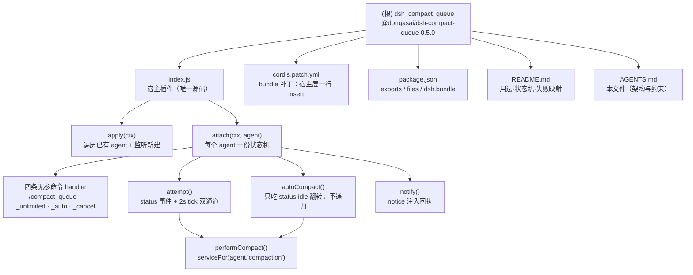

[根目录](./AGENTS.md) > **dsh_compact_queue**

# AGENTS.md

给在这个仓库里干活的 agent 看的：架构地图、硬约束、改动连带项。面向用户的用法、装法坑、回执原文
对照、排错与已知边界在 [README.md](README.md)，本文件不重复那些内容。与代码冲突时以代码为准。

**单模块仓**：源码只有一个文件 [index.js](index.js)，没有子目录模块，因此没有下级 `AGENTS.md`；
下文「模块索引」只是把文件级职责摊开，不构成可独立拆分的模块。

## 项目愿景

给每个 DSH 会话一组**能排队**的压缩命令（`/compact_queue` 及其三个无参兄弟命令）：

- 会话空闲 → 立刻压缩，回执规格与核心 `/compact` 一致（成功时带 `sourceEventSeq` 指向摘要事件）；
- 会话正忙 → 把请求排进**本会话**内存队列，等这个会话下一次 idle 自动补跑（默认最长等 24 小时；`/compact_queue_unlimited` 不设超时、无限等待）；
- `/compact_queue_auto` → 切换本会话自动压缩：开启后每次 AI 轮次结束（回 idle）压一次，**不递归**，只在本会话内存里（重启即关）；
- `/compact_queue_cancel` → 排队中撤销、执行中 `abort()`；auto 开着时连带关闭。

**命令必须无参**：DSH 的斜杠命令输入 UX 只认命令名，带空格的 `/compact_queue auto` 会被整段当成普通消息发给模型（`parseCommand` 虽解析 `rawInput`，但前端不送参数）。四种动作各占一个命令名；handler 保留对旧参数写法的兼容，但那不是主路径。

三条设计红线：

1. **不改核心**。核心 `/compact`（`@deepseek-ai/dsh-command-compact`）在非严格 idle 时只回一句
   busy 就丢请求，这是它的口径；本插件另注册一条命令，不碰它。
2. **作用域必须落在 agent**。`compactNow` 要求严格 idle 的 agent，排队要盯的是**这一个 agent**
   的状态翻转，不是全局某个会话。
3. **回执不伪装成用户消息，也不唤醒模型**。后台完成后用 `form: 'notice'` 注入，UI 折叠成一行
   summary，不额外烧 token。

## 架构总览

```
cordis.patch.yml  (宿主层 insert 一行)
        │
        ▼
apply(ctx)                            ← 宿主 ctx，拿得到 agents / agentPresets / commands
  ├─ ctx.agents.list()  ──┐
  └─ on('agent/created') ─┴─► maybeAttach(agent)   (WeakSet 去重 + isLive 复核)
                                 │
                                 ▼
                        attach(ctx, agent)          ← 每个 agent 一份状态机，监听/定时器挂在 agent.ctx
                          ├─ 状态机 state: none | queued | running（+ running 布尔锁）
                          ├─ autoEnabled 布尔（auto 开关，重启即关，只在本会话内存）
                          ├─ 返回该 agent 的 runCommand(mode)，四条无参命令共用，按 mode + invocation.agent 分派
                          ├─ agent.ctx.on('agent/status') → idle 翻转时 attempt(true) 或 autoCompact()
                          ├─ setInterval(2s).unref()      → attempt(false)   ← 兜底 tick（auto 不启动）
                          ├─ performCompact() → ctx.agentPresets.serviceFor(agent,'compaction')
                          │                     .compactNow(agent, signal)   ← 跨 realm 取服务
                          └─ notify() → agent.inject(createUserMessage({ source: { form:'notice' } }))
```

三条官方接缝（对应 `index.js` 文件头注释的「一」）：

| 接缝 | 用法 | 为什么 |
|---|---|---|
| 全局命令注册 | `ctx.commands.register()`（宿主 ctx，四条无参命令各注册一次，共用 handler） | **不能**用 `agent.ctx.commands`：agent scope 的 backing fiber 无 `inject`，`commands` 不在其 fiber 祖先链上，取属性直接抛 `cannot get property "commands" without inject`。命令全局注册，agent 维度由 handler 收到的 `invocation.agent` 决定 |
| 跨 realm 取服务 | `ctx.agentPresets.serviceFor(agent, 'compaction')` | compaction 挂在 preset 的 isolate realm，宿主层 `inject` 不到（注入发生在任何会话存在之前）。取不到就如实报错，不猜 |
| notice 注入 | `agent.inject(createUserMessage({ source: { kind:'compact-queue', form:'notice' } }))` | 与 `dsh-tool-jobs` 的完成通知同形制；不冒充 `kind:'user'`，不唤醒模型 |

**双通道触发**（缺一不可）：`agent/status` 只在 `idle ⇄ running` 字符串翻转时发射，而
`compactNow` 内部的 maintenance（idle→maintenance→idle）全程都是 idle、**不发事件**，所以除了
status 监听还要挂一个 2s 的 `unref()` tick 兜底；tick 同时承担默认 24 小时超时判定（`/compact_queue_unlimited`
排队置 `unlimited` 后跳过）。两条通道都汇进同一个 `attempt()`，靠 `running` 布尔 + state 机保证不重叠。

**auto 只吃 status 通道**（见 `index.js` 文件头「五」）：`autoCompact()` 只由 idle 翻转调用，
**不启动 tick、不排队**。正因为 maintenance 不发 idle 事件、notice 用 `wakeup=false` 注入，
压缩自身不会触发下一次压缩——这是「不递归」的硬依据，别给 auto 补 tick 兜底，那会变递归。
busy 时只跳过本次，不排队重试。autoEnabled 与排队状态共用 `running` 锁，二者不会重叠。

## 模块结构图



## 模块索引

| 模块 | 路径 | 职责 | 入口 | 生命周期 |
|---|---|---|---|---|
| 宿主插件 | [index.js](index.js) | 在宿主层注册四条无参全局命令（共用 handler），为每个 agent 维护独立的排队状态机，压缩完成/失败以 notice 回执 | `apply(ctx)` → `attach(ctx, agent)` | 宿主层加载；attach 出的监听器/定时器随 agent scope 卸载 |
| bundle 补丁 | [cordis.patch.yml](cordis.patch.yml) | `- insert:` 一行 `id: dsh-compact-queue`，把插件挂到宿主层 | — | profile 装载时读取 |
| 包元数据 | [package.json](package.json) | `name` / `exports` / `files` / `dsh.bundle.patch`；已设 `publishConfig.public`（尚未发 npm） | — | — |
| 用户文档 | [README.md](README.md) | 安装（Web / git 源 / `link:` 三种装法 + 装完确认 + 卸）、命令与回执原文对照表、结构/扩展点占用、排错、两层验证、已知边界 | — | — |

`locale/` 是空目录（git 不跟踪），当前没有 i18n 资源。

## 运行与开发

| 目的 | 做法 |
|---|---|
| 装进 profile | 三条通路：Web 插件页「添加插件」→ 点「立即启用」；`dsh plugin --profile web add github:dongasai/dsh_compact_queue#0.5`；`link:<仓库绝对路径>`。`dsh plugin` 走 `@deepseek-ai/dsh-plugin-manager/operations`，装完由 `reconcile()` 把声明了 `dsh.bundle` 的包自动选进 `dsh.profile.bundles`，**不需要手写注册行**。当前 web profile 是 `"@dongasai/dsh-compact-queue": "link:/data/ai/dsh/dsh_compact_queue"`（2026-11-22 由 `#0.2` 副本切过来）。**`link:` 坑**：DSH 按真身目录解析裸导入 `@deepseek-ai/*`，仓库里要放 `node_modules/@deepseek-ai` 符号链接指向 npx 安装内同名目录（本机已建，并用 `.git/info/exclude` 排除，不进版本库），否则启动报 `ERR_MODULE_NOT_FOUND`、bundle 激活失败；git 源 / tarball 装出来的是真实目录，没有这个坑 |
| 卸载 | `dsh plugin --profile web remove @dongasai/dsh-compact-queue`；`reconcile()` 会把它从 `dsh.profile.bundles` 一并摘掉，重启后命令消失 |
| 让改动生效 | **重启 `dsh web`**。命令在 `apply()` 里注册四条；模块按已解析 URL 进 ESM 缓存，`plugin_manager` 关→开**不会**重新 import，热改一律不生效。没有浏览器半边，不需要 `pnpm run dev:web` 之类的重建。验证装对了：`dsh --profile web --no-open --port 0` 起一个临时实例，看它能否加载该行，再杀掉，别动正在跑的服务 |
| 手工冒烟 | 在 dsh web 会话里敲 `/compact_queue` 看回执；忙时再敲一次应回「已排队」并在下一次 idle 自动补跑（摘要以折叠 notice 出现） |
| 依赖安装 | **不要 `npm install`**。源码是原始 ESM、裸导入 `@deepseek-ai/*`：git / tarball 装法由 DSH resolver 路由到安装内副本；`link:` 装法依赖仓库里那个 `node_modules/@deepseek-ai` 符号链接（见上），它让本机 `node --check` / `import()` 也能直接跑 |

## 测试策略

本仓库**没有自动化测试**（无 `test/`、无测试脚本、无 lint/格式化配置），验收靠人工冒烟。改状态机或
timer 逻辑时至少覆盖这五条：

1. **空闲直压**：idle 时 `/compact_queue` → 立即完成回执，带 `sourceEventSeq`。
2. **忙时排队**：running 时 `/compact_queue` → 回「已排队，最长 24 小时」；running 时 `/compact_queue_unlimited` → 回「无限等待，不设超时」，且超时不会清队列；本轮结束后自动补跑，摘要以 notice 出现。
3. **撤销**：排队中 `/compact_queue_cancel` → 「已撤销」且不再触发；执行中 → abort 生效，回执「压缩已取消」。
4. **重复入队**：排队中再次 `/compact_queue` → 报「已在队列中（约 N 分钟）」，不产生第二份压缩。
5. **agent 离场**：会话销毁时定时器清掉、执行中的压缩被 abort、日志无 unhandled rejection。
6. **auto 不递归**：`/compact_queue_auto` 开 → 每轮结束一条 `自动压缩完成：` notice；**不敲新消息不再出第二条**（关键：验证 compression 自身没触发自己）。
7. **auto 撤销/隔离**：auto 开着时 `/compact_queue_cancel` → 回执带「并关闭自动压缩」，之后不再自动压；两会话分别开 auto 互不影响；重启后 auto 默认关。
8. **命令名拦截**：四条命令在 `/` 补全菜单里都能出现，且敲下去都被拦截（不变成普通消息发给模型）。

无可用压缩范围时 `compactNow` 返回 `null`，按终态成功处理（「当前没有可压缩的历史」），不重试——
这是刻意口径，不是 bug。`ManualCompactionError` 除 `busy` 外全部终态，避免坏循环烧摘要请求。

## 编码规范

- **ESM + tab 缩进 + 单引号**，与 `index.js` 现状一致；不引入第三方依赖（只用 `@deepseek-ai/dsh-*` 与 `node:` 内置）。
- 注释写**为什么**（哪个官方接缝、哪条源码注释支撑），不写「这里做了什么」的复述；文件头用编号小节承载设计决策。
- 用户可见文案一律中文，且与核心 `/compact` 的失败口径对齐（`FAILURE_TEXT` 逐条映射 `ManualCompactionError.code`）。
- 新增/修改回执必须保持 `form: 'notice'`；任何时候都不得把系统回执标成 `kind: 'user'`。
- 常量集中在文件头（`QUEUE_TICK_MS`、`MAX_WAIT_MS`、`MAX_WAIT_TEXT`），文案常量（`USAGE`、`AUTO_ON_TEXT`、`AUTO_OFF_TEXT`、`FAILURE_TEXT`）放在函数之前；`/compact_queue_unlimited` 的无限等待由 `unlimited` 布尔控制，跳过 `MAX_WAIT_MS` 判定。
- auto 通道与排队通道共用 `running` 锁与 `activeAbort`：处理 auto 时先判 `state !== 'none'` 让排队优先，busy 只跳过不排队；新增触发通道必须同时核对「不重叠」与「不递归」两条。

## AI 使用指引

- **注册位置是硬约束**：四条命令都在宿主 `ctx.commands.register()` 上注册（各注册一次、共用 handler），动作靠 `mode`、agent 维度靠 `invocation.agent` 分流——`agent.ctx.commands` 在宿主层插件里必然抛错（见上表）。但监听器/定时器/teardown 仍走 `agent.ctx.on/effect`：那是 Context 自身成员，不触发服务解析，且随 agent scope 卸载。
- **别再给命令加参数**：DSH 的输入 UX 不送参数，`/compact_queue auto` 会整段变普通消息；新动作一律新注册一个无参命令名，别指望 `rawInput`。
- **改队列逻辑前先读 `attempt()` 全文**：`state`、`running`、`activeAbort`、`watcher` 四个变量互相牵制，只改一条通道（status 或 tick）会破坏「不重叠」保证。
- **别顺手"优化"乐观排队**：handler 先置 `queued` 再立刻试一次是刻意设计——省掉二次竞态判定，代价只是忙时多一次无副作用调用。
- **别给 auto 补 tick 兜底**：auto 的"不递归"完全依赖 maintenance 不发 idle 事件；一旦给它加轮询/排队，压缩自己就会触发下一次压缩，变成无限烧摘要请求。busy 跳过本次是刻意的。
- **两条已知问题在 README 末尾有账**：① tick 通道命中 24 小时超时是静默取消（`attempt(false)` 不发 notice，`/compact_queue_unlimited` 排队不设超时可绕过）；② `attempt()` 开头连续两次 `isLive()` 属死代码。修任一条要同步更新 README 的「已知边界」。
- **发版口径**：`package.json.version` 与 tag 同步（当前 `0.5.0` ↔ 附注 tag `0.5`，不带 `v`，与 `gitea_task_issues` 一致）；远端 `origin` = `git@github.com:dongasai/dsh_compact_queue.git`，发版＝本地提交 → `git tag -a 0.5 -m …` → `git push origin main` 与 `git push origin 0.5` 两条都推（只推分支会丢 tag）。直连 GitHub 超时，用 SOCKS5 代理：`GIT_SSH_COMMAND="ssh -o ProxyCommand='nc -X 5 -x 127.0.0.1:1080 %h %p' ssh" git push origin main`。
- 提交信息沿用 `类型(范围): 中文描述`（已落地的两条：`功能(压缩排队):`、`文档(接入):`）。

## 变更记录

- **2026-11-22T13:45+08:00** 命令改为**无参命令族**：用户实测 DSH 的斜杠命令输入框不接受参数（`/compact_queue auto` 整段被当普通消息发给模型），尽管后端 `parseCommand` 会解析 `rawInput`。`apply()` 由注册一条改为注册四条无参命令：`/compact_queue`、`/compact_queue_unlimited`、`/compact_queue_auto`、`/compact_queue_cancel`，共用 handler 按 `mode` + `invocation.agent` 分派；`runCommand(mode, invocation)` 保留旧参数写法兼容。README / AGENTS / `.agents/index.json` 同步命令名、排错口径、版本到 0.5。本机 web profile 从 `#0.2` 副本切到 `link:` 安装；为修 `ERR_MODULE_NOT_FOUND`，仓库内加了 `node_modules/@deepseek-ai` 符号链接（`.git/info/exclude` 排除），重启后需实测四条命令都能拦截。
- **2026-11-22T12:10+08:00** 新增 `/compact_queue auto`（每次空闲自动压缩，仅限当前会话，不递归）：`attach()` 增 `autoEnabled` 布尔，新增 `autoCompact()` 只由 `agent/status` 的 idle 翻转调用（不启动 tick、不排队，靠 maintenance 不发事件 + notice `wakeup=false` 保证不递归）；`cancel` 连带关 auto；`dispose` 清 autoEnabled。USAGE 加 auto、新增 `AUTO_ON_TEXT`/`AUTO_OFF_TEXT`，命令 description 更新。README（功能/用法/auto 专节/回执/排错/验证/已知边界）与本文件（愿景/架构图/双通道/模块图/测试/编码规范/AI 指引）同步更新。已纳入 `0.4`（已推送到 origin）；本机 web profile 仍指向 0.2 副本，需切依赖 + 重启才生效。
- **2026-11-22T12:15+08:00** 发版 `0.4`：承接上条的 `/compact_queue auto`，`package.json.version` → `0.4.0`，附注 tag `0.4` 指向提交 `a3d19c2`。README / AGENTS / `.agents/index.json` 的版本号、钉版本示例、发版口径、tag 清单同步到 0.4。直连 GitHub 的 SSH(22)/HTTPS(443) 超时，改走本地 SOCKS5 代理 `socks5h://127.0.0.1:1080`（`GIT_SSH_COMMAND` 里配 `nc -X 5 -x` 的 ProxyCommand）后，`git push origin main` 与 `git push origin 0.4` 均成功；`git ls-remote` 核对远端 main 与 `0.4^{}` 都是 `a3d19c2`。本机 web profile 仍指向 `#0.2`，未随发版切换（切依赖 + 重启是独立动作）。
- **2026-11-21T17:47+08:00** 发版 `0.3`：`package.json.version` → `0.3.0`，附注 tag `0.3` 随 `main` 一并推送到 origin。README / AGENTS / `.agents/index.json` 的版本号、钉版本示例、发版口径、tag 清单同步到 0.3；`package.json` 既有的去 `private` + `publishConfig.public` 改动随本次一并提交（尚未发 npm），文档里对应的 `private: true` 描述已改为实际状态。本机 web profile 仍指向 `#0.2`，未随发版切换。
- **2026-11-21T17:36+08:00** 排队默认时长 30 分钟 → 24 小时，并新增 `/compact_queue ~`（无限等待）：`MAX_WAIT_MS` 改 24h，新增联动文案常量 `MAX_WAIT_TEXT` 避免回执显示「1440 分钟」；`attach()` 增 `unlimited` 布尔，`~` 置位后跳过超时判定、`stopQueue()` 复位；USAGE 与忙时回执区分「最长等待 24 小时」/「无限等待，不设超时」。README（功能/用法/回执对照/排错/验证/已知边界）与本文件（愿景/双通道/模块图/测试/编码规范/已知问题）同步更新。同日发版 `0.3`。
- **2026-10-21T11:20+08:00** 发版 `0.2`：`package.json.version` → `0.2.0`，附注 tag `0.2` 随 `main` 一并推送。实测依据：宿主命令目录里 `compact_queue` 与 `compact`/`permission`/`plan` 并列；忙时排队后由 idle 通道补跑，回执 `排队压缩完成：压缩了 217 条历史（约 144578 tokens）。`。`.agents/index.json` 同步：命令 `scope` 由 `agent` 改为 `host`、`registeredVia` 改 `ctx.commands.register()`、版本与 tags 更新；当日本机 profile 依赖由本地 tarball 切到 `github:dongasai/dsh_compact_queue#0.2`（装完 `index.js` md5 与本仓一致，`import()` 与 `--dump-config` 均通过）。
- **2026-10-20T14:35+08:00** 修「命令从未注册」：`agent.ctx.commands.register()` 在宿主层插件里必抛 `cannot get property "commands" without inject`（agent scope 的 backing fiber 无 inject，`commands` 不在其 fiber 祖先链上），改为宿主 `ctx.commands.register()` 全局注册一次 + handler 按 `invocation.agent` 分流状态机；profile 改用本地 tarball 装成真实目录。README 的「仅本会话可见」与扩展点表同步改写。
- **2026-10-20T11:15+08:00** 安装章节按 gitea README 的写法重写：恢复「Web 界面装法」（插件页 → 添加插件 → 立即启用，第六版误判为不存在）、删掉「必须手写 `dsh.profile.bundles`」的错误步骤（`dsh plugin` 已走 `@deepseek-ai/dsh-plugin-manager/operations`，装完由 `reconcile()` 自动选中 bundle）、补齐「副本 vs `link:`」区别、无构建步骤说明、装完 `--dump-config | grep -A1` 的实测三行输出与 `systemctl --user restart dsh.service` 提示。
- **2026-10-20T11:05+08:00** 按插件 README 编写规范（`note/readme-spec.md` §2.3）重写 README 安装章节：改成「装 → 登记 bundles → 重启 → 确认」四步编号（每步带命令 + 期望输出），明说没有 registry 装法且插件市场搜不到，补「首次配置：没有」的「情况 → 显示 → 动作」表；`--dump-config` 期望输出改为本机实测三行；删掉重复的独立「确认它真的在工作」「生效条件」两节（并入第 3、4 步）。
- **2026-10-20T10:05+08:00** 按「dsh 插件 README 编写经验」重写 README：补三种装法与四条坑（`--profile` 必填、`bundles` 清单必须手加、`github:` 前缀、tag 必须真实）、回执原文对照表、扩展点占用表、两层验证、已知边界逐条带原因与代价；同时纠正旧 README 的装法——`plugin_manager` 是桌面端内置工具，本环境没有，登记 bundles 也不会由 `dsh plugin` 代劳。
- **2026-10-20T09:52+08:00** 远端落定：`origin` = `git@github.com:dongasai/dsh_compact_queue.git`（新建空仓，`git ls-remote` 无任何 ref）；附注 tag `0.1` 重挂到本提交后与 `main` 一并推送。
- **2026-10-19T20:46+08:00** 初始化架构文档：新增本文件与 `.agents/index.json`；扫描覆盖 4/4 个被跟踪文件（100%）。无子模块，故不生成下级 `AGENTS.md`。
- **2026-10-19T20:29+08:00** `29c6b52 文档(接入): 补 cordis.patch.yml 与 README，使包可按 bundle 装入 profile`
- **2026-10-19T20:20+08:00** `c8b85bf 功能(压缩排队): agent 作用域 /compact_queue 命令，busy 时排队、下次 idle 自动补跑`
